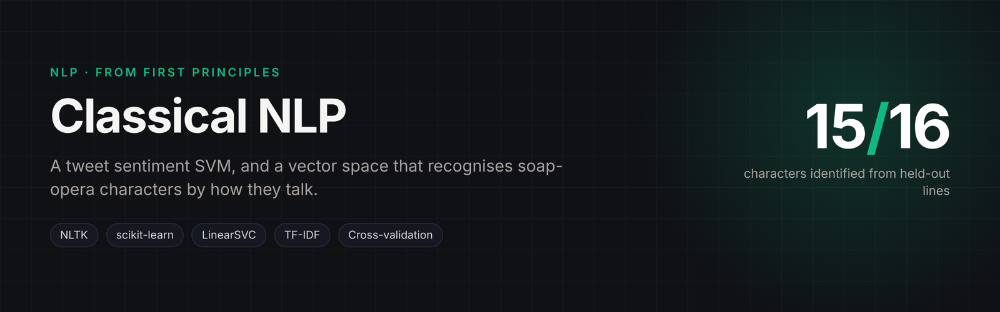
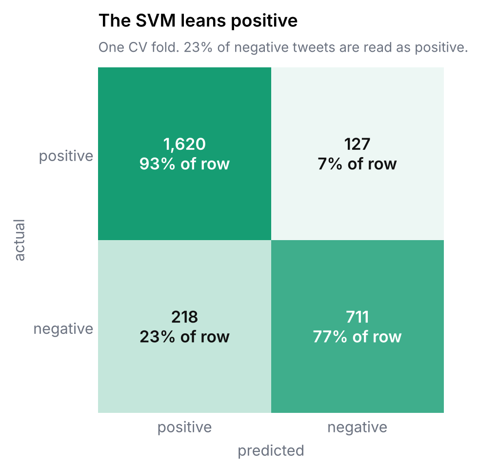
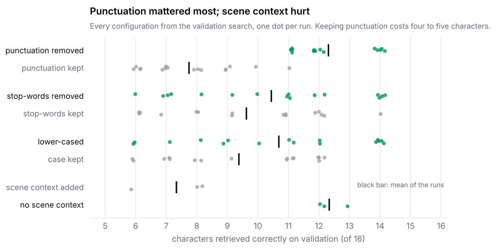

<p align="center"></p>

# Classical NLP: Sentiment Classification and Vector-Space Similarity

Two NLP projects built from first principles with NLTK and scikit-learn: no pre-trained embeddings,
every feature engineered and evaluated by hand.

## 1. Tweet sentiment classification

**Notebook:** [`01_tweet_sentiment.ipynb`](01_tweet_sentiment.ipynb)

Binary sentiment classification of ~27,000 labelled tweets with a linear SVM.

- Pre-processing: lower-casing, removal of non-alphabetic characters, whitespace tokenisation,
  lemmatisation, and experiments with stop-word removal and trigrams.
- Features: unigram + bigram bag-of-words, fed to a scikit-learn `LinearSVC` pipeline.
- Evaluation: 10-fold cross-validation with precision, recall, F1 and accuracy per fold.
- Error analysis: false positives and false negatives are exported and inspected to drive the next
  round of pre-processing and feature changes.

| Setup | Result |
|---|---|
| 10-fold CV, best pipeline | **F1 0.898**, accuracy 0.866 |

<p align="center"></p>

Recall (0.92) runs ahead of precision (0.88): the classifier is biased towards the positive
class, and the error analysis shows why. The false positives are dominated by neutral,
forward-looking words such as *tomorrow*, *may* and *game*, which carry little sentiment of
their own.

## 2. Character similarity in TV scripts

**Notebook:** [`02_character_vector_similarity.ipynb`](02_character_vector_similarity.ipynb)

Each character in a soap-opera script becomes a document of their lines. The task is to build a
vector space where a character's held-out lines land closest to their own training vector, measured
by retrieval rank among 16 characters.

- Better pre-processing and linguistic features (POS tags, n-grams), TF-IDF weighting.
- Dialogue context and scene features: the surrounding lines in a scene added to each line (tested, and rejected).
- Systematic parameter search over the feature and weighting choices.
- Analysis of which characters are confused with which, and why.

| Setup | Result |
|---|---|
| Baseline representation | 14 / 16 correct |
| Final system on the test set | **15 / 16 correct (93.75%)**, mean rank 1.06 |

<p align="center"></p>

The search was more informative than the final number. Stripping punctuation was the single
most important choice (12.3 vs 7.8 characters on average), while adding the surrounding scene
lines, a reasonable-sounding idea, cut validation accuracy from about 12 to about 7, most
likely because those lines are spoken by other characters and blur the stylistic signal the
vectors depend on.

## Run it

```bash
pip install -r requirements.txt
jupyter notebook
```

The tweet and script datasets were provided for teaching and are **not included**. Place a
tab-separated sentiment file (label, text) and the script `training.csv`, `val.csv` and `test.csv`
next to the notebooks to re-run them.
